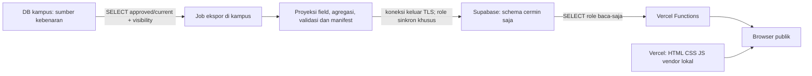

# Audit dan rancangan cermin publik — Vercel + Supabase

Tanggal audit/sumber daring: **16 Oktober 2026 (Asia/Jakarta)**. Status: **layak bersyarat sebagai cermin baca-saja; belum siap diterapkan**. Tahap ini hanya dokumen. Tidak membuat akun/project, mengakses DB, mengubah kode/konfigurasi/`.env`/migration/seed, menjalankan tes aplikasi, atau melakukan deployment.

Sumber kebenaran, login, pengisian, verifikasi, revisi dan audit tetap di kampus. Publikasi cloud membutuhkan izin tersendiri atas **domain, field, tingkat agregasi, periode dan penyedia**; status approved aplikasi tidak otomatis berarti diizinkan dipindah ke pihak ketiga. Rancangan ini melengkapi pilihan deployment publik pada [FASE-6.md](FASE-6.md), bukan memulai Fase 6/E2 atau menggantikan gerbang operasional internal.

## 1. Dasar audit, kesimpulan dan temuan

Acuan dibaca: [STATUS.md](STATUS.md), [FASE-6.md](FASE-6.md), [MATRIKS-INPUT.md](MATRIKS-INPUT.md), aturan [AGENTS.md](../AGENTS.md), route/service/frontend dan definisi view/master SQL terkait. Inventaris adalah **hasil pembacaan checkout**, bukan bukti respons HTTP atau isi DB produksi terkini. Nilai `visibilitas_modul`, `PUBLIC_DASHBOARD`, data approved, akun, jaringan dan paket cloud belum diperiksa secara live.

| Temuan | Bukti checkout | Keputusan rancangan |
|---|---|---|
| Tinggi: seluruh aplikasi tidak dapat langsung dipindahkan sebagai portal publik. | [server/app.js](../server/app.js), baris 31–69: sesi PostgreSQL, semua router auth/tulis/internal dan Excel dipasang; baris 73–101: guard HTML. | Paket cermin tersendiri dengan daftar halaman/API/aset yang diizinkan; tidak menjalankan `server/app.js` di cloud. |
| Tinggi: publik menurut repo lebih luas daripada lingkup tugas ini. | [dashboard.js](../server/routes/dashboard.js), baris 43–55: `/pegawai` publik untuk dosen tetap/tidak tetap dan pengecualian `/tendik-total`; MATRIKS baris 19–22. | **Keduanya dilarang di cermin ini**, termasuk kartu/grafik turunannya. Kebijakan aplikasi kampus tidak diubah. |
| Tinggi: respons publik tidak boleh disalin mentah. | dashboard.js baris 15–20 mengirim `catatan_publik` quality flag sebagai `meta.catatan_kualitas`; [research.js](../server/routes/research.js), [cooperation.js](../server/routes/cooperation.js), [productivity.js](../server/routes/productivity.js), [accreditation.js](../server/routes/accreditation.js) dan master GET memakai `SELECT *` terhadap view/master. | Proyeksi field eksplisit sebelum keluar kampus; quality flags seluruhnya dikeluarkan, termasuk pesan/kode yang sudah muncul di API publik. View tertentu sudah membatasi field, tetapi perubahan view di masa depan tetap tidak boleh otomatis ikut ekspor. |
| Sedang: frontend bersama masih bergantung pada auth dan endpoint yang ditolak cermin. | [navbar.js](../static-web/assets/js/navbar.js):43 memanggil `getUser()`; [home.js](../static-web/assets/js/home.js):27,68 memanggil tendik-total/pegawai. | Adaptasi frontend khusus cermin diperlukan nanti; menyembunyikan menu saja tidak mencukupi. |
| Sedang: agregat kecil/free text tetap dapat mengungkap orang atau konteks internal. | Statistik dosen/mahasiswa, tracer/prestasi, `sumber`, `mitra_institusi`, `nama_sumber`, nomor SK. | Agregasi dan pemeriksaan pelindungan data sebelum ekspor; default field yang belum disahkan tidak dikirim. |
| Tinggi untuk keputusan biaya: Vercel Hobby dibatasi penggunaan pribadi nonkomersial. | [Vercel Hobby](https://vercel.com/docs/plans/hobby), diakses 16 Oktober 2026. | Jangan menjanjikan portal institusi gratis. IT/pengadaan memeriksa kelayakan paket/ketentuan dan anggaran; bila tidak sesuai, berhenti atau pilih hosting lain. |

**Kelayakan:** arsitektur cermin memungkinkan dashboard tetap terbaca saat jaringan kampus terganggu, dengan tambahan tanggung jawab sinkron, penarikan publikasi, rahasia cloud dan biaya. Belum ada bukti kapasitas, grant/RLS, sinkron, pemulihan atau deployment yang lulus. Jangan menganggap status tes historis aplikasi sebagai verifikasi cermin.

## 2. Inventaris halaman yang dapat menjadi publik

Semua baris berikut **kandidat yang harus disanitasi**, tunduk pada izin cloud dan visibility sumber. Nama file/path dipertahankan sebagai rencana kompatibilitas, bukan file baru yang sudah dibuat.

| Halaman | API sumber `/api/dashboard/...` | Batas isi cermin |
|---|---|---|
| `/index.html` (dan `/`) | `summary`, `mahasiswa`, `mahasiswa-angkatan`, `dosen`, `prodi`, `akreditasi`, `pmb-peminat` | Kartu/grafik domain tersebut saja. Kartu tendik dan grafik dari `pegawai` tidak dibawa; tidak menggantinya dengan angka rekaan. |
| `/statistik-mahasiswa.html` | `mahasiswa`, `mahasiswa-angkatan` | Jumlah agregat, pembatasan gender/status/angkatan pada kelompok kecil. |
| `/mahasiswa-baru.html` | `mahasiswa-baru` | Target/daftar ulang dan snapshot; peminat institusi tetap metrik terpisah. |
| `/statistik-dosen.html` | `dosen` | Agregat akademik dosen; bukan inventaris pegawai. Gender/S3/jafung rinci membutuhkan penggabungan kelompok. |
| `/lulusan.html` | `lulusan`, `tracer` | Institusi dan prodi dipisahkan; tracer awalnya ringkasan institusi, tanpa rincian kelompok kecil. |
| `/daftar-prodi.html`, `/kinerja-prodi.html` | `prodi` | Nama/jenjang dan agregat mahasiswa/dosen; bukan KPI/IKU atau skor kinerja baru. |
| `/rasio-dosen-mahasiswa.html` | `rasio-dosen-mahasiswa` | Pasangan approved pada prodi/periode yang sama; denominator dosen tetap, kelengkapan jelas. |
| `/akreditasi.html` | `akreditasi` | Institusi/prodi/internasional approved/current; sumber belum terpetakan tetap terpisah, tanpa flag/aktor internal. |
| `/penelitian.html`, `/hki.html`, `/pkm.html` | `penelitian`, `hki`, `pkm` | Jumlah per kategori/tahun; **`dana` dikeluarkan** dari penelitian/PkM sesuai pembatasan keuangan tugas. |
| `/prestasi-mahasiswa.html` | `prestasi` | Jumlah agregat; tidak ada nama/NIM/kegiatan individu. |
| `/kerja-sama.html` | `kerjasama` | Agregat per cakupan; nama institusi hanya setelah pemeriksaan, bukan PIC/nilai kontrak. |
| `/produktivitas-dosen.html` | `produktivitas-dosen` | Institusi: publikasi, beban-mengajar, pelatihan; satuan berbeda tidak dijumlah. Tidak membaca KPI/pegawai. |
| `/beban-mengajar.html`, `/rekognisi-dosen.html`, `/kinerja-pt.html` | `beban-mengajar`, `rekognisi-dosen`, `kinerja-pt` | Boleh berupa keadaan kosong existing. Tidak menciptakan BKD, rekognisi individu atau skor PT. Opsional dikeluarkan dari navigasi MVP. |

Terdapat **18 halaman kandidat** pada tabel (termasuk tiga halaman kosong), **20 path dashboard kandidat**, dan tiga master GET pendukung. Semua selain daftar eksplisit ditolak secara default.

**Tidak dibawa:** `/keuangan.html`, `/monitoring-kpi.html`, `/monitoring-iku.html`, `/ami.html`, `/statistik-tendik.html`, `/pegawai-formasi.html`, `/kualitas-data.html`; kedua alias `/capaian-iku-{fakultas,universitas}.html` yang mengarah ke KPI; `/login.html`, `/ganti-password.html`, `/ruang-unit.html`, `/input/*`, `/verifikasi.html`, `/admin/*`. Di cloud, path internal tidak tersedia (404/no-store), bukan redirect ke login cloud. Perilaku 401/redirect login kampus tetap mengikuti aplikasi existing.

API yang ditolak: `/api/dashboard/{keuangan,kpi,iku,ami,tendik,tendik-total,pegawai,pegawai-internal,pegawai-formasi,formasi,pegawai-pergerakan}`, `/api/kpi/*`, `/api/rka-target`, `/api/quality-flags*`, `/api/auth/*`, `/api/forms/*`, `/api/data/*`, `/api/verification/*`, `/api/imports/*`, `/api/admin/*`, seluruh metode tulis master, serta path tak dikenal. Tidak ada endpoint proxy generik menuju kampus/Supabase.

## 3. Field per endpoint dan proyeksi cermin

### Notasi dan aturan bersama

Daftar di bawah menginventarisasi field **respons saat ini menurut kode**, lalu menentukan proyeksi cermin. Semua path pada tabel pertama berawalan `/api/dashboard/`, metode GET (HEAD nanti hanya header setara). Nama kelompok berikut adalah singkatan dokumentasi, bukan field API baru:

- **P** = `prodi_id, prodi_kode, prodi_nama, jenjang`.
- **A** = `periode_akademik_id, periode_akademik_kode, tahun_ajaran, semester_akademik`.
- **L** = `periode_laporan_id, periode_laporan_kode`.
- **S** = `sumber_id, sumber`.
- **M** = `meta.sumber[] {dokumen, nomor_tabel, halaman_pdf, halaman_cetak}`, `meta.catatan_kualitas[] {kode, pesan}`. Metadata kualitas ini **tidak boleh ikut**.
- **U** = `meta.empty, meta.message, meta.data_sementara, meta.catatan`; empat field ini dihasilkan loop dashboard umum, meskipun bukan semua bermakna pada setiap domain.

Untuk cermin: P/A/L dipakai hanya pada grain yang disahkan; `prodi_id`/ID periode adalah ID referensi internal, bukan kode Dikti. ID record domain, `sumber_id`, raw `sumber`, metadata quality flag, riwayat/aktor/versi internal dikeluarkan. Sumber publik diganti sitasi terkurasi dengan field **`dokumen, nomor_tabel, halaman_pdf, halaman_cetak` saja**, tanpa menyalin laporan mentah/path/checksum laporan/catatan bebas. `message` berasal dari teks keadaan kosong yang disetujui, bukan raw exception atau komentar operator.

| Endpoint | `data` existing | Metadata existing di luar `data` | Field/grain usulan untuk cermin |
|---|---|---|---|
| `mahasiswa` | P+A+L+S; `total, perempuan, status_mhs` | M+U | P+A+L+`total,status_mhs`; `perempuan` hanya agregat aman. Awal: total per prodi, komposisi gender/status lebih rinci pada institusi/jenjang yang disahkan. |
| `mahasiswa-angkatan` | P+A+L+S; `angkatan,total` | M+U; `rekonsiliasi {mahasiswa_aktif,total_angkatan,selisih,catatan}` | A+L+`angkatan,total` institusi/jenjang; prodi×angkatan ditahan sampai pemeriksaan kelompok kecil. `rekonsiliasi` internal tidak disalin. Jangan mengalokasikan selisih. |
| `mahasiswa-baru` | P+A+L+S; `tahun_masuk,tanggal_snapshot,target,realisasi_daftar_ulang` | M+U | Field tersebut kecuali S, pada grain prodi bila aman; tidak mengambil pendaftar/peminat dari KPI. |
| `pmb-peminat` | A+L+S; `jumlah_peminat,tahun_masuk,tanggal_snapshot,nomor_tabel,halaman_pdf,halaman_cetak,total`; bila kosong hanya `{total:null}` | Tidak ada `meta` | A+L+`total,tahun_masuk,tanggal_snapshot` institusi dan sitasi terkurasi; `total` alias `jumlah_peminat`, satu metrik, bukan dua kartu. |
| `dosen` | P+A+L+S; `total,perempuan,s3,tenaga_pengajar,asisten_ahli,lektor,lektor_kepala,guru_besar` | M+U | P+A+L+`total`; gender/S3/jafung awal hanya institusi/jenjang setelah pemeriksaan. Jangan ikut `pegawai_ringkasan`, tendik/PKWT atau persentase KPI jafung. |
| `lulusan` | P+A+L+S; `cakupan,tahun_lulus,periode_wisuda,jumlah,ipk_rata` | M+U | P+A+L+`cakupan,tahun_lulus,jumlah`; `periode_wisuda`/`ipk_rata` ditahan pada MVP karena terlalu rinci pada kohor kecil. `masa_studi_rata` ada di form/domain, **tidak dikirim endpoint ini**, tidak ditambahkan ke cermin. |
| `tracer` | P+A+L+S; `tahun_lulus,jumlah_lulusan,responden,kerja_kurang_3_bulan,kerja_lebih_3_bulan,sesuai_bidang,wirausaha,studi_lanjut` | M+U; `ringkasan[] {L,tahun_lulus,responden,jumlah_lulusan,cakupan_persen,data_sementara}`, `total_wirausaha` | MVP hanya ringkasan institusi L+`tahun_lulus,responden,jumlah_lulusan,cakupan_persen,data_sementara`. Rincian outcome/prodi dan `total_wirausaha` ditahan sampai agregasi aman. Ringkasan bukan penjumlahan rincian belum lengkap. |
| `summary` | Objek `mahasiswa,dosen,mahasiswa_baru,lulusan`; tiap kartu berisi A+L+`total,coverage,sumber,delta`; mahasiswa juga `perempuan,persen_perempuan`; PMB juga `tahun_masuk,tanggal_snapshot`; lulusan juga `tahun_lulus`. Kartu kosong `{total:null,delta:null}`. | Tidak ada `meta` | Empat objek tersebut dengan A+L+`total` dan tahun/snapshot yang relevan; perempuan/persen hanya agregat aman. `coverage,sumber,delta` tidak ikut MVP; delta existing hanya dihitung untuk mahasiswa/dosen. Cermin boleh menyajikan kelengkapan terkurasi terpisah. |
| `prodi` | `id,kode,nama,jenjang,mahasiswa,dosen,akreditasi` (akreditasi saat ini selalu NULL pada endpoint ini) | M+`empty` | `id,kode,nama,jenjang,mahasiswa,dosen`; akreditasi hanya lewat domain akreditasi yang sah, tidak menebak dari NULL endpoint ini. Master aktif saja. |
| `rasio-dosen-mahasiswa` | P+A+L; `mahasiswa,dosen,mahasiswa_per_dosen,sumber` | `empty,message,rumus,institusi {mahasiswa,dosen,mahasiswa_per_dosen,lengkap,cakupan,total_prodi}`, `sumber[] {dokumen}` | P+A+L+jumlah/rasio; institusi dan rumus boleh. Sitasi dipecah menjadi field terkurasi. Rasio NULL bila denominator/kelengkapan tidak sah. |
| `akreditasi` | `id,butir,cakupan`, P, `nama_sumber,peringkat,nomor_sk,lembaga,berlaku_mulai,berlaku_sampai,status_sumber`, L+S | `prodi[],rekap_master[],total_master,total_rekap,konsisten,jumlah_peringkat,tanpa_data,duplikat,periode_laporan_id,sumber,empty,message,rekap[],total,belum_terpetakan,institusi[],internasional[]` | `cakupan`, P, L, `peringkat,lembaga,berlaku_mulai,berlaku_sampai,status_sumber`; `nomor_sk,nama_sumber,butir` setelah review PJM. Rekap publik terkurasi; `id,S,duplikat,konsisten` tidak ikut. Jangan menyalin objek bersarang mentah. |
| `penelitian` | `id,kategori,tahun,target,realisasi,dana`, L+S+`kategori_label` | `sumber,empty,message,catatan` | L+`kategori,kategori_label,tahun,target,realisasi`; **tanpa dana**. Tidak ada judul/peneliti individu. |
| `hki` | `id,kategori,tahun,target,diajukan,disetujui`, L+S+`kategori_label` | `sumber,empty,message,catatan` | L+`kategori,kategori_label,tahun,target,diajukan,disetujui`. Tidak memuat pemegang/pencipta/nomor identitas individu. |
| `pkm` | `id,kategori,tahun,target,realisasi,dana`, L+S+`kategori_label` | `sumber,empty,message,catatan` | L+`kategori,kategori_label,tahun,target,realisasi`; **tanpa dana**. |
| `prestasi` | P; `tahun,jumlah_mahasiswa,nasional,regional,internasional,pkm_dikti`, S+`periode_laporan_kode,has_data` | `sumber,totals {jumlah_mahasiswa,nasional,regional,internasional,pkm_dikti},empty,message,tanpa_rincian` | Tahun/periode, lima hitungan; MVP institusi/jenjang, detail prodi setelah pemeriksaan. `has_data` boleh diterjemahkan menjadi kelengkapan, tanpa S. Mahasiswa berprestasi berbeda dari penghargaan. |
| `kerjasama` | `id,tahun,kategori,jumlah,baris_sumber,total_kosong,selesai,berjalan,tahap_penjajakan,proses_penjajakan,dibatalkan,mitra_institusi`, L+S+`kategori_label` | `sumber[] {id,dokumen,nomor_tabel,halaman_pdf,halaman_cetak}`, `message` | L+`tahun,kategori,kategori_label,jumlah,selesai,berjalan,tahap_penjajakan,proses_penjajakan,dibatalkan`; nama mitra opsional setelah review. `baris_sumber,total_kosong` tidak disalin; bila jumlah parsial, tampilkan keterangan kelengkapan terkurasi atau tahan metrik. Cakupan tidak dijumlah sebagai mitra unik. |
| `produktivitas-dosen` | `id,kategori,tahun,target,realisasi,capaian_laporan,capaian_hitung`, L+S+`kategori_label` | `sumber,empty,message,catatan` (kondisi `catatan` pada route ini saat ini menghasilkan NULL) | Semua field substantif kecuali ID/S, **institusi** dan kategori allowlist `publikasi,beban-mengajar,pelatihan`. Capaian laporan/hitung tetap terpisah; bukan KPI/IKU. |
| `beban-mengajar` | `[]` | `empty,message` | Tetap kosong; tidak membagi rata-rata beban mengajar institusi ke prodi. |
| `rekognisi-dosen` | `[]` | `empty,message` | Tetap kosong; tanpa nama/rekognisi individu baru. |
| `kinerja-pt` | `{akreditasi:null}` | `message` | Tetap kosong; bukan endpoint gabungan KPI/IKU/keuangan. |

Rincian metadata akreditasi: `prodi[]` dibentuk dari master aktif dan record matching, dengan field record `data` di atas ditambah `jumlah_catatan`; tanpa record hanya identitas master/peringkat NULL/jumlah_catatan. `institusi[]`/`internasional[]` memakai bentuk record `data`. `rekap[]` dan `rekap_master[]` masing-masing `{jenjang,peringkat,jumlah,persentase}`; total existing berbasis baris sumber berbeda dari total master. Cermin menghitung ulang rekap dari proyeksi approved yang sama, mempertahankan master tanpa data dan sumber belum terpetakan sebagai kategori terpisah; tidak membuat pemetaan fakultas atau menyamakan nama secara otomatis. Bukti: [accreditation.js service](../server/services/accreditation.js).

| API pendukung | Field existing menurut DDL + route | Proyeksi cermin |
|---|---|---|
| GET `/api/master/prodi` | `id,kode,urutan,nama,jenjang,kode_dikti,fakultas,aktif,created_at,updated_at` | Master aktif yang diperlukan: `id,kode,urutan,nama,jenjang`; kode internal bukan Dikti. Fakultas/kode Dikti dikeluarkan sampai sumber dan kebutuhan disahkan. |
| GET `/api/master/periode-akademik` | `id,kode,tahun_ajaran,semester,urutan,mulai,selesai,aktif,created_at,updated_at` | `id,kode,tahun_ajaran,semester,urutan,aktif` pada periode yang ada dalam snapshot; tanggal hanya jika ada kebutuhan publik disetujui. |
| GET `/api/master/periode-laporan` | `id,kode,tahun,semester,mulai,selesai,urutan,aktif,created_at,updated_at` | `id,kode,tahun,semester,urutan,aktif` pada periode dalam snapshot. |
| GET `/api/health` kampus | `{data:{status:'ok'}}`, tidak memeriksa DB khusus | Tidak disalin sebagai bukti kesehatan. Usulan health cermin hanya status proses dan kesiapan snapshot; tanpa host/role/string koneksi. Pemeriksaan rinci oleh monitor IT terpisah. |

Bukti field: [dashboard.js](../server/routes/dashboard.js), [ratio.js](../server/routes/ratio.js), [research.js](../server/routes/research.js), [achievements.js](../server/routes/achievements.js), [cooperation.js](../server/routes/cooperation.js), [productivity.js](../server/routes/productivity.js), [accreditation.js](../server/routes/accreditation.js), [admin.js](../server/routes/admin.js):47–58, [001 master](../db/migrations/001_master.sql), [004 views](../db/migrations/004_dashboard_views.sql), [008 sources](../db/migrations/008_dashboard_sources.sql), [011 tracer](../db/migrations/011_tracer_current_denominator.sql), [013 akreditasi](../db/migrations/013_accreditation.sql), [014 riset](../db/migrations/014_research_domains.sql), [016 kerja sama](../db/migrations/016_cooperation.sql), [017 produktivitas](../db/migrations/017_faculty_productivity.sql), [032 peminat](../db/migrations/032_pmb_peminat.sql). Tidak mengubah byte berkas tersebut.

### Data pribadi, rincian berlebih dan agregasi

**Dilarang seluruhnya:** nama/NIM/NIK/NIP/email/telepon/alamat orang, identitas pengisi/reviewer, `created_by,submitted_by,approved_by,reviewed_by,review_note`, sesi/token/password, `unit_id` kepemilikan, audit log, payload Excel, histori versi, raw quality flags/kutipannya, komentar operator dan laporan mentah. Tidak ada field identitas mahasiswa/dosen pada proyeksi kandidat di atas; free text dan kelompok kecil tetap memerlukan review.

| Field/kombinasi berisiko | Alasan | Agregat/pembatasan yang diusulkan |
|---|---|---|
| Gender/status/angkatan × prodi/periode; gender/S3/jafung dosen × prodi | Orang dapat dikenali pada sel kecil atau lewat selisih total. | Total per prodi bila disahkan; komposisi pada jenjang/institusi. Jangan menawarkan kombinasi filter yang dapat membuka kembali sel tertahan. |
| Tracer outcome/wirausaha/studi lanjut; prestasi internasional/PKM per prodi | Outcome personal dan kelompok kecil, termasuk rekonstruksi dari total. | Ringkasan institusi dahulu; kelompok lebih luas atau tahan field beserta total pelengkap yang membuka sel. Nilai tertahan diberi alasan publik umum, **bukan diganti 0**. |
| `ipk_rata,periode_wisuda` dan kohor kecil lulusan | Rata-rata dapat mendekati nilai seseorang. | Jumlah institusi/tahun; rata-rata hanya setelah ambang kohor disahkan BAA/pelindungan data. |
| `sumber,meta.catatan,meta.message`, `mitra_institusi,nama_sumber,nomor_sk,butir` | Bisa berisi nama/PIC/path internal atau informasi belum diumumkan. | Sitasi terstruktur; nama institusi/SK publik yang diverifikasi. Tidak mengandalkan regex untuk mengesahkan teks. |
| `dana`, angka keuangan, data pegawai/tendik dan semua quality flag | Di luar lingkup meskipun suatu respons existing publik. | Dikeluarkan dari ekspor, JSON, log publik dan cache. |

Ambang jumlah minimum, perlakuan nol vs NULL, penggabungan kelompok, penahanan sel pelengkap dan risiko perbandingan lintas snapshot harus disahkan pelindungan data/unit; **tidak ada ambang angka yang diasumsikan sudah sah**. Sampai itu selesai, field rinci berisiko ditahan. Statistik yang tidak lengkap diberi label parsial; jangan memakai SUM yang menganggap NULL nol atau membentuk total lengkap dari sebagian baris. Metadata cermin boleh menambahkan `kelengkapan`/`ditahan` tanpa alasan internal. Kontrak ini merupakan proyeksi baru yang memerlukan adaptasi renderer nanti, bukan janji respons mentah identik.

## 4. Arsitektur satu arah dan pilihan penyimpanan

Panah menunjukkan aliran data; tidak ada jalur tulis, webhook masuk, foreign data wrapper atau replika dua arah dari cloud ke DB kampus. Cloud tidak menyimpan credential DB kampus, akun aplikasi, audit atau dump kampus. Firewall kampus tidak membuka PostgreSQL/Express ke internet untuk kebutuhan cermin. Job hanya menerima hasil koneksi cloud sebagai sukses/gagal, tidak mengeksekusi perintah/query dari cloud. Persetujuan/revisi/four-eyes tetap di aplikasi kampus dan tidak bergantung pada keberhasilan cloud.

| Pilihan | Bentuk, kelebihan | Biaya/risiko dan keputusan |
|---|---|---|
| **A — direkomendasikan bila tetap memakai Vercel + Supabase** | Project Supabase terpisah, schema non-exposed misalnya `mirror`; tabel snapshot/manifest/pointer khusus cermin, dapat menyimpan payload JSONB yang sudah disanitasi per endpoint/periode. Vercel hanya membaca snapshot aktif. Pembaruan data tidak perlu deploy frontend. | Perlu grants/RLS, koneksi/pooling, monitor, dua credential terpisah dan anggaran. Tidak memindahkan tabel domain aplikasi atau menjalankan migration kampus di Supabase. |
| **B — JSON statis** | Job kampus menghasilkan JSON terkurasi + manifest/checksum; diterbitkan bersama paket statis versi baru di Vercel melalui proses rilis. Supabase tidak diperlukan pada runtime; bisa dihilangkan bila dipilih murni statis. | Lebih sedikit komponen, tetapi tiap pembaruan perlu publikasi artefak; build/deploy/traffic dihitung, snapshot lama dapat tetap tersedia lewat URL deployment. Penarikan publikasi dan kedaluwarsa server lebih sulit. Tidak cocok untuk kebutuhan pencabutan akses cepat tanpa lapisan baca/penjaga tambahan. |

Jika ingin JSON disimpan di Supabase Storage, itu **varian tersendiri**, bukan otomatis aman karena Data API dimatikan: Storage memiliki API/policy sendiri. Bucket publik tidak dapat melaksanakan pembatasan snapshot/penarikan yang sama. Tidak menjadi rekomendasi awal. Tidak perlu SDK Supabase di browser untuk pilihan A.

### Pemilihan data dan penerbitan snapshot

1. Job kampus berdiri terpisah dari runtime aplikasi. Usulan role lokal khusus `mirror_exporter` hanya SELECT proyeksi publik/master/visibility yang diperlukan; tidak memakai owner atau membawa password `app_user` ke cloud. Runtime aplikasi tetap `APP_DB_USER=app_user`. Pembuatan role/proyeksi lokal merupakan pekerjaan DBA terotorisasi nanti melalui perubahan baru, tidak mengubah migration/seed lama.
2. Ambil snapshot konsisten dalam transaksi baca-saja; domain hanya `status='approved' AND is_current_approved`, melalui view/proyeksi yang diaudit. Master tidak mempunyai workflow approval: gunakan daftar aktif/terkurasi, bukan mengarang status approved master. `current` adalah versi sah **per grain/periode**, bukan selalu tahun terbaru; periode yang boleh disalin ditetapkan eksplisit. Akreditasi memilih satu snapshot laporan yang sesuai, bukan menjumlah semester. Tracer memakai denominator lulusan institusi current yang berpasangan sebagaimana view 011.
3. Evaluasi `PUBLIC_DASHBOARD`, `visibilitas_modul.akses='public'`, `aktif`, seluruh dependensi modul, serta daftar izin cermin yang lebih sempit. Untuk summary/prodi/rasio, semua sumber dependennya harus publik. Visibility tidak diketahui/berubah menjadi privat berarti domain dikeluarkan, bukan memakai izin lama. Baca ulang kebijakan sebelum aktivasi; perubahan saat ekspor membatalkan kandidat dan mengulang pada siklus berikutnya.
4. Validasi schema ketat, tipe, ukuran/jumlah baris, field/kategori/filter allowlist, NULL, cakupan dan tidak adanya metadata terlarang **sebelum keluar kampus**. Jangan menyalin respons HTTP mentah; jangan memanggil `/api/data/*` memakai sesi admin. Agregasi/penahanan berlangsung di job, bukan hanya disembunyikan di browser.
5. Buat `schema_version, release_id, policy_version, source_exported_at, source_checked_at, published_at, valid_until`, daftar domain/periode, jumlah record dan checksum payload. Nama-nama ini adalah **usulan metadata cermin**, belum kolom existing. `source_checked_at` menunjukkan pembacaan sumber/izin berhasil, bukan bahwa data periodenya baru. Tidak mengirim timestamp/identitas reviewer per record.
6. Usulan tambahan integritas: manifest ditandatangani di kampus memakai kunci privat khusus, Vercel memverifikasi dengan kunci publik; checksum saja tidak mengautentikasi sumber. Tanda tangan meliputi payload hash, periode, izin, waktu dan masa berlaku. Ini tidak menjamin freshness ketika snapshot lama yang masih berlaku diputar ulang; label waktu/batas berlaku tetap wajib. Algoritme/format/penyimpanan kunci ditetapkan pada kontrak implementasi.
7. Upload satu kandidat lengkap ke Supabase dengan role sinkron. Dalam satu transaksi cloud: masukkan kandidat, validasi konsistensi, aktifkan pointer. Reader hanya dapat membaca release aktif; staging dan histori ditutup. Pembaca menyertakan `release_id` untuk seluruh panel; bila pointer berubah di tengah pemuatan, balas konflik terkontrol dan muat ulang satu release, tanpa mencampur angka.
8. Aktivasi idempotent menggunakan release/checksum dan urutan job; satu job aktif, kandidat lama tidak boleh menimpa kandidat lebih baru. Retry terbatas/backoff, aman bila koneksi putus sebelum/sesudah COMMIT. Manifest dan pointer tidak diperbarui sebagai sukses sampai transaksi berhasil terkonfirmasi. Log internal hanya release/domain/jumlah/durasi/status, tanpa payload atau credential.

### Frekuensi, kegagalan dan penarikan

**Usulan awal untuk disetujui IT/PRP:** sinkron terjadwal tiap **30 menit** dari scheduler kampus, peringatan setelah **60 menit** tanpa pemeriksaan sumber yang berhasil, batas keras layanan snapshot **24 jam**. Ini target rancangan, **bukan batas penyedia atau SLA yang sudah disahkan**. IT dapat memilih nilai lebih ketat setelah mengukur kapasitas dan kebutuhan penarikan data. Job tetap memeriksa izin saat tidak ada perubahan angka; saat isi sama, tandai waktu pemeriksaan, jangan menyatakan periode data berubah.

| Pemicu | Penilaian |
|---|---|
| Terjadwal — pilihan pertama | Tidak perlu mengubah transaksi approval untuk MVP; mencakup revisi, perubahan visibility, periode/master, dan pemulihan setelah job gagal. Jadwal/alert dikelola IT pada host kampus, bukan Vercel yang menarik DB kampus. |
| Setelah approval — akselerator opsional | Job lokal dipicu setelah COMMIT sah; tidak memanggil cloud dari trigger/transaksi approval. Bila perlu antrean/outbox lokal, rancang terpisah dan uji atomisitas/idempotensi. Kegagalan cloud tidak membatalkan approval. Scheduler rekonsiliasi tetap diperlukan untuk event terlewat dan perubahan visibility/master. |

- **Upload/validasi gagal:** pointer tetap ke snapshot terakhir yang lengkap dan masih berizin/berlaku; tidak mengirim array kosong sebagai sukses. UI selalu menampilkan **“Diperbarui pada … WIB”** dari waktu snapshot yang dilayani dan periode data, serta **“Pemeriksaan sumber terakhir … WIB”** bila berbeda. Waktu request/deploy/browser tidak menggantikan waktu sumber.
- **Job kampus mati/internet putus:** umur dihitung dari manifest, termasuk saat tidak ada sinyal kegagalan baru. Saat melewati ambang peringatan tampil **“Salinan belum diperbarui; data mungkin basi”** pada semua halaman/panel terkait. IT menerima alert melalui mekanisme operasional yang nanti disetujui; tidak ada pengiriman pesan/konfigurasi alert pada tahap dokumen.
- **Supabase tidak dapat dibaca:** fungsi menghasilkan 503/no-store dan halaman error/retry. Fallback last-known-good hanya bila dirancang eksplisit dengan checksum/izin/expiry yang sama; MVP tidak menjanjikan fallback yang belum ada. Tidak menampilkan nol atau data seed sebagai pengganti.
- **`valid_until` lewat/izin tidak sah/tanda tangan invalid:** fungsi menolak data (503 atau domain 404/no-store sesuai sebab) dan UI mengosongkan angka. Pemeriksaan di server wajib; jam browser hanya untuk tampilan. Halaman yang sudah terbuka memeriksa umur lewat timer dan saat kembali aktif/online, memperbarui banner atau mengosongkan angka saat kedaluwarsa; tanpa service worker/offline cache data. Kegagalan perpanjangan harus menutup layanan saat masa berlaku habis.
- **Visibility dicabut/insiden:** IT menghentikan domain atau seluruh cermin melalui kontrol cloud, menonaktifkan pointer/reader bila perlu, mencabut credential yang terdampak, dan membersihkan cache/artefak/URL deployment terkait. Jadwal normal memberi jeda pencabutan hingga siklus berikutnya; jika jeda tidak dapat diterima, perlu prosedur emergency kill cloud dan masa berlaku lebih singkat. **Data publik yang sudah diunduh pengguna tidak dapat ditarik kembali**; ini batas yang perlu diterima pelindungan data.
- **JSON statis:** manifest dan banner tetap wajib; kedaluwarsa di JavaScript saja bukan kontrol akses. Bila perlu penghentian server setelah expiry atau pencabutan segera, gunakan fungsi penjaga dan tutup akses langsung JSON lama, atau pilih A. Jangan menyatakan file publik immutable aman untuk data yang perlu dicabut.

## 5. Keamanan Supabase dan koneksi

Rekomendasi: project khusus cermin, **Data API/PostgREST dimatikan** melalui pengaturan Data API; schema cermin tidak dimasukkan exposed schemas. Dokumentasi resmi menyatakan endpoint REST otomatis tidak merespons ketika Data API dimatikan, terlepas dari grants/RLS. Jika API tetap diperlukan untuk kebutuhan lain yang disetujui, cabut akses `anon`/`authenticated` terhadap schema/objek cermin dan batasi exposed schemas; tetap uji REST/RPC/GraphQL secara negatif. [Securing your API](https://supabase.com/docs/guides/api/securing-your-api), diakses 16 Oktober 2026.

Changelog resmi tentang **auto-exposure tabel** menyebut perubahan untuk project baru dan penerapan menyeluruh yang dijadwalkan **30 Oktober 2026**. Pada tanggal audit, jangan bergantung pada default project lama/baru; tinjau grant/default privilege nyata. [Changelog Data/GraphQL API](https://supabase.com/changelog/45329-breaking-change-tables-not-exposed-to-data-and-graphql-api-automatically), diakses 16 Oktober 2026. Indeks changelog juga dibaca; perubahan relevan harus diperiksa kembali ketika implementasi dimulai.

### Matriks role dan grants yang akan dibuktikan nanti

| Role/konteks | Hak yang dirancang | Larangan |
|---|---|---|
| `mirror_owner` (maintenance IT, bukan runtime) | Memiliki schema/DDL cermin, menetapkan grant/RLS melalui proses perubahan. Usulan owner NOLOGIN dengan admin maintenance terpisah. | Tidak dimasukkan env Vercel/job harian. |
| `mirror_reader` (Vercel server saja) | LOGIN khusus, CONNECT database, USAGE schema minimum, SELECT snapshot/manifest/pointer yang aktif; RLS SELECT hanya release aktif dan masih berlaku. | Bukan owner/superuser/BYPASSRLS; tanpa CREATE, role membership berlebih, tulis tabel/sequence, TRUNCATE, EXECUTE fungsi yang tidak perlu atau akses schema lain. |
| `mirror_sync` (job kampus saja) | DML terbatas pada tabel cermin untuk staging/aktivasi yang atomik dan pemeriksaan kandidat; RLS khusus writer. | Tanpa DDL/GRANT/BYPASSRLS atau akses DB kampus dari cloud. Retensi/penghapusan snapshot lama oleh maintenance terpisah, bukan reader. |
| `anon`, `authenticated`, `PUBLIC` | Tidak memperoleh USAGE/SELECT/DML/EXECUTE pada objek cermin; default privileges ditutup untuk setiap role pembuat objek. | Tidak ada policy publik `USING(true)` untuk anon/authenticated. Jangan menganggap RLS menggantikan REVOKE. |

Aktifkan RLS pada seluruh tabel cermin sebagai pertahanan tambahan; policy hanya role layanan yang ditentukan. Reader dan sync bukan pemilik tabel. Gunakan tabel sederhana atau view `security_invoker=true` bila perlu; jangan membuat view/fungsi SECURITY DEFINER sebagai jalan pintas. Policy release aktif harus juga melindungi akses langsung dengan ID yang ditebak, staging dan histori. `default_transaction_read_only` dapat menjadi tambahan reader, **bukan pengganti grant**. Buat bukti negatif SELECT schema lain, INSERT/UPDATE/DELETE/DDL/RPC dan akses role anonim, bukan hanya login berhasil. [RLS](https://supabase.com/docs/guides/database/postgres/row-level-security), [Postgres Roles](https://supabase.com/docs/guides/database/postgres/roles), diakses 16 Oktober 2026.

Mematikan Data API tidak otomatis menutup Storage, Realtime, Edge Functions, Auth atau koneksi SQL. Cermin tidak menggunakan layanan tersebut; pastikan tidak ada bucket publik, publication Realtime/Edge Function berhak luas atau sign-up aplikasi yang tidak diperlukan. Tinjau paparan setiap produk tersendiri. [Secure configuration of Supabase products](https://supabase.com/docs/guides/security/product-security), diakses 16 Oktober 2026.

### Pooler vs direct

| Pemakaian | Pilihan koneksi dan alasan |
|---|---|
| Vercel Functions yang singkat | Shared transaction pooler: dirancang untuk banyak koneksi singkat/serverless. Hindari ketergantungan state sesi antartransaksi. Pool kecil per instance dan timeout; batas keseluruhan tetap perlu diukur karena instance dapat bertambah. |
| Job kampus yang periodik | Shared session pooler untuk kompatibilitas jaringan IPv4/state sesi; direct bila jaringan IPv6/opsi jaringan project memungkinkan dan kebutuhan terukur. Job dapat memakai transaksi eksplisit, tanpa LISTEN dari cloud ke kampus. |
| DDL/maintenance khusus | Direct atau session pooler sesuai alat/jaringan; credential maintenance IT terpisah. Tidak menggunakan reader atau owner dalam fungsi publik. |

Shared pooler menyediakan IPv4; direct bergantung dukungan IPv6/opsi IPv4 project. Ambil host/mode/user role khusus dari dialog **Connect**, jangan membentuk hostname dari ingatan. TLS wajib dengan verifikasi sertifikat yang sesuai driver; jangan mengatasi error dengan menonaktifkan verifikasi. Nilai pool/timeout ditetapkan sesudah uji. [Connect to your database](https://supabase.com/docs/guides/database/connecting-to-postgres), diakses 16 Oktober 2026.

Transaction pooler tidak mendukung prepared statements bernama. Untuk `node-postgres`, tetap query parameterized, tetapi jangan memberi properti `name`; driver lain mengikuti panduannya. SET/state sesi tidak diandalkan lintas transaksi; pengaturan transaksi memakai transaksi yang sama. [Disabling Prepared statements](https://supabase.com/docs/guides/troubleshooting/disabling-prepared-statements-qL8lEL), diakses 16 Oktober 2026. Pemakaian driver baru di paket cermin perlu justifikasi; tidak mengubah dependency aplikasi kampus pada tahap ini.

### Rahasia, pemilik dan rotasi

Nama di bawah adalah **usulan nama variabel**, bukan konfigurasi yang sudah ada. Tidak ada nilai, URL bercredential atau project ref nyata dalam dokumen. Simpan nilai di vault IT/dashboard secret berwenang, jangan chat/repo/artefak/frontend. Pisahkan staging/production dan batasi akses pengembang berdasarkan waktu.

| Nama variabel saja | Pemilik dan lokasi nanti | Tujuan/batas |
|---|---|---|
| `CAMPUS_MIRROR_READ_URL` | DBA/IT kampus; vault service scheduler lokal | Credential `mirror_exporter`, SELECT lokal saja; tidak pernah di Vercel/Supabase/CI cloud. |
| `SUPABASE_MIRROR_SYNC_URL` | IT sinkron/DBA; vault job kampus | Credential `mirror_sync`, tulis cloud cermin saja; tidak di fungsi baca. |
| `SUPABASE_MIRROR_READ_URL` | IT cloud; env **server** Vercel sesuai environment | Credential `mirror_reader`; tidak masuk JS, JSON, source map atau prefix env publik. |
| `MIRROR_SIGNING_PRIVATE_KEY` | IT keamanan kampus; vault job lokal | Menandatangani manifest; tidak dikirim cloud. |
| `MIRROR_VERIFY_PUBLIC_KEY` | IT keamanan/cloud; konfigurasi Vercel | Kunci publik, bukan rahasia; untuk verifikasi sumber/rotasi key ID. |
| `SUPABASE_MAINTENANCE_URL` | DBA cloud; vault maintenance | Provisioning/DDL/retensi saja, tidak runtime/scheduler harian. |
| `SUPABASE_ACCESS_TOKEN` | Admin IT cloud; vault sementara jika memakai CLI/API administrasi | Opsional, tidak diperlukan pembacaan snapshot; hapus/cabut setelah tugas maintenance. |
| `VERCEL_TOKEN`, `VERCEL_DEPLOY_HOOK_URL` | IT rilis; vault CI/job rilis bila diperlukan | Opsional untuk publikasi aplikasi/opsi JSON, bukan dibutuhkan sinkron SQL pilihan A; bukan URL publik. Scope minimum. |
| `DNS_API_TOKEN` | Admin DNS IT; vault DNS | Opsional otomasi DNS; tidak ke aplikasi/fungsi. |
| `SUPABASE_SERVICE_ROLE_KEY`, `SUPABASE_SECRET_KEY`, `SUPABASE_ANON_KEY`, `SUPABASE_PUBLISHABLE_KEY` | Admin project mengelola lifecycle; **tidak diisikan ke frontend atau fungsi cermin pilihan A** | Tidak diperlukan untuk koneksi SQL role khusus. `service_role`/secret berhak tinggi dan melewati RLS; publishable/anon bukan pengganti grants/RLS. |

Credential/password DB kampus, `SESSION_SECRET`, owner kampus dan `DEMO_PASSWORD_*` tetap lokal; tidak disalin/diubah untuk cermin. Variabel nonrahasia rancangan seperti `MIRROR_ENABLED`, `MIRROR_SCHEMA_VERSION`, `MIRROR_STALE_AFTER_SECONDS` dan `MIRROR_MAX_AGE_SECONDS` dikelola IT terpisah dari nilai rahasia. Kill switch berbasis env Vercel memerlukan deployment baru; emergency stop yang cepat memakai pointer/grant cloud dan pengujian seluruh URL aktif.

Rotasi: inventaris konsumen → siapkan credential/role pengganti dengan hak sama → ubah secret konsumen → deploy/restart konsumen yang perlu → buktikan baca/sinkron → cabut credential lama dan koneksi aktifnya secara terkontrol. Pastikan rollback tidak menghidupkan credential lama. Rotasi dilakukan saat kebocoran, offboarding/serah terima dan jadwal IT yang disahkan. API key modern/legacy punya mekanisme berbeda; ikuti dokumentasi aktual sebelum menonaktifkan key. **Tidak ada `service_role`/secret key di frontend**, termasuk bila key tampak diblokir browser. [Supabase API keys](https://supabase.com/docs/guides/getting-started/api-keys), diakses 16 Oktober 2026.

## 6. Arsitektur Vercel, header, cache dan paket

Paket cermin tersendiri berisi HTML multipage vanilla, CSS/JS, logo/font/Chart.js lokal dan lisensi vendor yang dipakai. Tidak memerlukan framework, CDN library baru atau build frontend baru. Langkah packaging hanya memilih/menyalin aset yang disahkan dan memeriksa manifest; bukan mengirim seluruh `static-web`/repo. Fungsi Node baca-saja memetakan allowlist path/filter ke payload snapshot Supabase dan mengembalikan proyeksi ketat. Vercel mendukung fungsi Node pada direktori `api/`; routing terkait dapat digabung pada handler bersama. [Node.js Runtime](https://vercel.com/docs/functions/runtimes/node-js), diakses 16 Oktober 2026.

**Tidak dipaketkan:** Express aplikasi kampus, login/sesi/CSRF write recovery, input/verifikasi/admin/imports/master tulis, Excel/fflate/parser/worker/preview/apply/kuota, SSE/EventSource/Realtime, seed/demo, laporan mentah/dump, `.env`, `.runtime`, docs/arsip dan kode backend internal. Jangan menyertakan skrip bersama yang menginisialisasi auth atau membawa navigasi privat; renderer publik diadaptasi secara terbatas nanti, dengan navbar/footer satu sumber di paket cermin. Cookie kampus tidak digunakan cloud dan domain cookie kampus harus ditinjau IT agar tidak mencakup subdomain cermin.

Aturan fungsi: GET/HEAD allowlist saja; metode lain 405/no-store, path privat/tidak dikenal 404/no-store, filter tidak sah 422/no-store. Tidak ada SQL/URL/domain endpoint yang diterima bebas dari klien, tidak ada write/RPC/sinkron publik. Parameter periode/prodi/tahun/jenjang hanya yang tercantum snapshot; pembatasan kelompok kecil ditegakkan di server/artefak. Tidak menyimpan sesi atau membuat `Set-Cookie`; log aman tanpa query credential/payload. CORS same-origin secara default; API publik tetap dapat diunduh pihak lain, sehingga CORS bukan kontrol kerahasiaan.

### CSP/Helmet dan cache

Helmet existing tetap di kampus. HTML/aset statis Vercel tidak melewati middleware Express tersebut; header setara harus diatur untuk **seluruh respons**, termasuk error/redirect/aset/fungsi, melalui konfigurasi cermin dan header fungsi. Vercel menyediakan konfigurasi `headers`, `rewrites`, `outputDirectory` dan pengaturan fungsi; output directory dipilih khusus cermin. [Project Configuration](https://vercel.com/docs/project-configuration), [vercel.json](https://vercel.com/docs/project-configuration/vercel-json), diakses 16 Oktober 2026.

Usulan kebijakan untuk diuji: CSP `default-src 'self'`, script/font lokal, `connect-src 'self'`, `object-src 'none'`, `base-uri 'self'`, `frame-ancestors 'none'`, `form-action 'none'`; audit style inline yang dipakai Chart.js sebelum menetapkan `style-src` final. `img-src` hanya kebutuhan logo/aset lokal dan data URL bila terbukti perlu. Tambahkan `X-Content-Type-Options: nosniff`, Referrer-Policy, Permissions-Policy minimum dan perlindungan framing. HSTS dipasang setelah HTTPS/domain siap; `includeSubDomains` tidak diterapkan ke seluruh domain kampus tanpa keputusan IT. Nilai final harus diuji, bukan menyalin header tanpa memeriksa renderer.

| Respons | Kebijakan awal usulan | Alasan |
|---|---|---|
| API payload/manifest/health, error/404/405/422/503, maintenance | `Cache-Control: no-store`; tidak ada override cache CDN yang melonggarkan | Masa berlaku/penarikan dan pesan basi dievaluasi pada tiap baca. Periksa juga `CDN-Cache-Control`/`Vercel-CDN-Cache-Control`. |
| HTML shell publik | Revalidasi (`max-age=0,must-revalidate`) atau no-store pada halaman maintenance; tidak mengandung angka tertanam | Memperbarui navigasi/kebijakan tanpa menahan shell lama; data diambil melalui fungsi. |
| CSS/JS/font/logo vendor dengan nama berfingerprint | Cache panjang + immutable setelah strategi versi terbukti | Hanya aset yang tidak berisi data/rahasia. Nama URL lama tanpa versi memakai TTL pendek/revalidasi. |
| JSON statis pilihan B | Revalidasi pada manifest, versi/checksum pada payload; izin cache data diputuskan terpisah | URL lama dapat tetap tersaji; jangan memakai cache immutable data yang perlu dicabut. |

Dokumentasi Vercel membedakan prioritas header cache CDN dan browser; `Vercel-CDN-Cache-Control` dapat mengalahkan `Cache-Control`, dan `no-store` dipakai untuk konten yang tidak boleh disimpan. Uji header hasil deployment sebenarnya, bukan hanya konfigurasi source. Cache API pendek hanya dievaluasi kemudian bila pengukuran membuktikan kebutuhan dan invalidasi/expiry/penarikan lulus; bukan bagian MVP. [Cache-Control headers](https://vercel.com/docs/caching/cache-control-headers), diakses 16 Oktober 2026.

### Domain, HTTPS dan environment

Gunakan subdomain publik milik kampus yang ditetapkan IT; tidak mengasumsikan nama/domain tertentu tersedia. Origin internal tetap kampus/VPN; cloud tidak me-rewrite ke host internal. IT menambah domain di Vercel lalu mengubah record DNS yang ditampilkan dashboard, memeriksa propagasi/CAA/TLS/redirect HTTP→HTTPS dan pemulihan record lama. Tidak perlu memindahkan seluruh nameserver kampus untuk satu subdomain. Vercel menyediakan pengelolaan domain dan sertifikat otomatis setelah konfigurasi DNS valid; tetap monitor kegagalan TLS. [Working with domains](https://vercel.com/docs/domains/working-with-domains), [Panduan DNS/SSL resmi Vercel](https://vercel.com/kb/guide/a-record-and-caa-with-vercel), diakses 16 Oktober 2026.

Pisahkan Development/Preview/Production dan project data staging. Preview memakai fixture sintetis tanpa data pribadi; production credential tidak tersedia pada preview/fork atau pipeline tidak terpercaya. Set versi Node 22 pada paket cermin bila masih didukung saat implementasi, lalu buktikan runtime nyata. Perubahan environment Vercel berlaku pada **deployment baru**, bukan deployment lama; pilih Secret untuk credential ketika tersedia di dashboard, batasi tim dan jangan menganggap env tidak dapat bocor melalui bundling/log. [Environment variables](https://vercel.com/docs/environment-variables), diakses 16 Oktober 2026.

### Paket gratis: pemeriksaan pengguna sebelum memilih

Tidak ada angka kuota/harga gratis yang dijanjikan dalam rencana ini. Pengguna/IT mencatat paket, region, tanggal, kuota aktual, harga setelah kuota, mata uang/pajak, penanggung biaya dan tindakan ketika batas tercapai dari halaman resmi/dashboard berikut. Free tier bukan SLA operasional.

| Penyedia | Hal yang wajib diperiksa dan dibandingkan kebutuhan | Sumber resmi, diakses 16 Oktober 2026 |
|---|---|---|
| Vercel | Kelayakan institusi terhadap aturan penggunaan Hobby; anggota/team/RBAC; bandwidth/data transfer, request, function invocations/compute/memory/duration/concurrency/payload; build/deploy, log/retensi, domain/protection/region, batas billing/spend dan dukungan | [Hobby](https://vercel.com/docs/plans/hobby), [Limits](https://vercel.com/docs/limits). Hobby bukan otomatis pilihan sah untuk institusi. |
| Vercel bila memilih JSON atau cron | Frekuensi/ketepatan jadwal, kuota deployment, otorisasi job dan biaya; job ekspor utama tetap di kampus | [Cron Jobs usage/pricing](https://vercel.com/docs/cron-jobs/usage-and-pricing). Tidak mengasumsikan cron cloud dapat menjangkau DB kampus. |
| Supabase | Database size/compute, storage/egress/cache egress, koneksi/pooler, jumlah project aktif, region/IPv4, backup/restore/PITR, log/retensi, dukungan dan batas biaya per organisasi/project | [Pricing](https://supabase.com/pricing), [Billing](https://supabase.com/docs/guides/platform/billing-on-supabase). |
| Supabase Free | Kebijakan pause karena aktivitas rendah, pemulihan, kehilangan akses ketika pause dan kecocokan jam layanan portal | [Project Pausing](https://supabase.com/docs/guides/platform/free-project-pausing). Ada kebijakan pause Free; jangan mengandalkan ping buatan sebagai jaminan layanan. |

Ukur payload snapshot, request per kunjungan, trafik harian/puncak dan jumlah koneksi sebelum memilih paket. Perhitungkan biaya dua penyedia, domain, penyimpanan/vault/monitor dan jam operator; jumlah kecil data bukan bukti seluruh biaya nol.

## 7. Urutan langkah pengguna dan Codex pada tahap berikutnya

**Semua langkah di bagian ini adalah pekerjaan mendatang setelah instruksi implementasi yang baru.** Saat ini berhenti di dokumen. Persetujuan rancangan tidak otomatis mengotorisasi provisioning, biaya, perubahan DB, upload data atau rilis publik.

| Urutan/titik berhenti | PENGGUNA / atasan / IT | Codex pada tahap implementasi berikutnya | Bukti sebelum berlanjut dan rollback |
|---|---|---|---|
| **G0 — keputusan publikasi dan pemilik** | Sahkan matriks field/agregasi/periode, izin pihak ketiga/region, pilihan A/B, paket/biaya, domain, PIC utama/pengganti dan penarikan data. | Audit ulang checkout/visibility yang diotorisasi, tulis kontrak schema/policy dan rencana file terisolasi. | Berhenti bila izin field/cloud/biaya/PIC belum ada. Rollback: tetap dashboard kampus; belum ada data cloud. |
| **G1 — akun/project kosong** | Buat akun institusi di Vercel dan Supabase, MFA serta recovery terkelola; organisasi/team milik kampus. Buat project Supabase staging, tentukan region/password melalui vault; project production baru setelah bukti staging. Cek biaya dahulu. | Siapkan source/paket cermin lokal dan rancangan perubahan grant/RLS **reviewable sebelum diterapkan**, tanpa rahasia. | Tidak memakai akun pribadi pengembang sebagai pemilik tunggal. Jangan impor seluruh repo dari tombol Vercel yang langsung deploy; import hanya paket tersanitasi saat G4. Rollback: hapus akses sementara/nonaktifkan resource kosong sesuai keputusan IT, tanpa menyentuh kampus. |
| **G2 — provisioning keamanan staging** | DBA menerapkan role/schema/policy cloud yang telah ditinjau dan mematikan Data API; otorisasi perubahan role ekspor kampus tersendiri. | Setelah diotorisasi, bantu perubahan **baru** terisolasi/SQL staging; verifikasi role reader/sync terpisah dan penolakan anonim/tulis/objek lain. | Tidak memasukkan data riil. Berhenti jika reader dapat menulis, API langsung terbuka atau akses kampus melebar. Rollback: REVOKE role cermin/disable job; tidak reset/restore DB kampus. |
| **G3 — eksportir dan sinkron uji** | Sediakan host scheduler kampus, vault, egress firewall, PIC/alarm; masukkan credential lokal sesuai tabel rahasia, terpisah dari `.env` aplikasi existing. | Implementasi proyeksi/snapshot/manifest/idempotensi/expiry/tanda tangan; uji di DB terisolasi `_test` dan Supabase staging dengan fixture sintetis. | Buktikan hanya approved/current dan publik; private/draft/submitted/rejected/discarded tidak keluar, visibility dicabut menutup layanan, NULL/agregasi benar, retry/COMMIT parsial tidak mengubah pointer. Rollback: matikan scheduler/cabut `mirror_sync`; aplikasi kampus tetap berjalan. |
| **G4 — frontend dan Vercel preview** | Import repo/paket **khusus cermin** yang sudah diperiksa ke Vercel, pilih root/output directory cermin, runtime yang disepakati; masukkan `SUPABASE_MIRROR_READ_URL` staging dan konfigurasi verifikasi/umur di Settings → Environment Variables sesuai environment. Tidak menyalin `.env` kampus. | Adaptasi navbar/footer/renderer publik, hilangkan auth dan panel terlarang; handler baca-saja, header/cache/error/360px. Siapkan kandidat preview konkret dan manifest paket sebelum publikasi preview yang diotorisasi. | Uji tidak ada auth/write/Excel/SSE/request ke kampus, path/encoded path/metode tak dikenal tertutup, endpoint terlarang 404, nilai sesuai snapshot, CSP/keyboard/reduced motion/360px. Berhenti pada preview sampai review. Rollback: nonaktifkan preview/revoke reader staging. |
| **G5 — review, gangguan dan pemulihan** | IT/pelindungan data/unit meninjau sampel field, melakukan latihan tanpa pengembang dan menerima waktu basi/expiry/pencabutan. | Review baca-saja terpisah; perbaikan pada sesi implementasi terotorisasi, retest. Uji kampus offline/job mati, Supabase down, kuota/429/timeout, snapshot invalid/expired, rotasi dan rollback. | Nol gap Tinggi/Kritis terbuka; bukti real network/headers/deny grants dan regresi yang relevan. Artefak/test bukan persetujuan publikasi otomatis. Rollback: kandidat terakhir sah atau maintenance, jangan memperpanjang expiry agar tes hijau. |
| **G6 — production dan domain** | Buat/set project production yang disepakati; IT memasukkan secret production **hanya Production**, memilih jadwal/job, domain/DNS dan budget/alarm. Atasan/pelindungan data mengesahkan field dan IT menetapkan jendela rilis. | Setelah kandidat siap dan izin rilis eksplisit: bantu provisioning/rilis terbatas yang disepakati, ekspor data riil sah, smoke anonim/role negatif serta cek tanggal/snapshot/header/DNS/HTTPS. | Berhenti sebelum deploy produksi, upload data riil dan perubahan DNS bila izin spesifiknya belum ada. Rollback frontend, data cloud dan DNS diuji terpisah sebagaimana bagian berikut. |
| **G7 — serah terima** | Dua petugas IT menerima akun/vault/source, tagihan, jadwal monitor/rotasi, kontak insiden, dukungan dan pemilik pascakontrak. | Lengkapi runbook, kamus field/filter, manifest rilis, bukti uji/rollback/rotasi, backlog dan batas layanan. | IT menjalankan sinkron, stop/pulih, rotasi dan penarikan domain sendiri. Cabut akses pengembang setelah pengalihan. Tidak membuka E2/BKD/Proyeksi baru. |

### Rollback dan penarikan yang berbeda jenis

1. **Aplikasi Vercel:** kembalikan deployment kompatibel yang diketahui aman atau deploy maintenance. Instant Rollback mengembalikan build/konfigurasi deployment lama; perubahan env terbaru tidak otomatis diterapkan padanya. Tidak memulihkan database Supabase. Setelah rotasi secret, lebih aman membuat deployment baru dari source aman dengan credential baru daripada menghidupkan build bercredential dicabut. [Instant Rollback](https://vercel.com/docs/instant-rollback), diakses 16 Oktober 2026.
2. **Data cermin:** hentikan job, periksa release terakhir yang masih memenuhi izin/expiry, lalu aktifkan kembali secara atomik jika sah. Data lama yang sudah dicabut/expired tidak boleh dijadikan fallback. Bila tidak ada kandidat sah, tampilkan maintenance; jangan mengubah tanggal agar data tampak baru. Tidak menulis balik/restore approved kampus. Simpan catatan operasi internal, tanpa menyalin audit aplikasi ke cloud.
3. **Insiden bocor:** penarikan didahulukan daripada rollback biasa; blokir reader/pointer/domain, revoke credential, periksa deployment/JSON/cache lama serta salinan artefak sesuai prosedur IT. Jangan rollback ke rilis yang masih memuat field bocor. Catat batas bahwa unduhan publik yang sudah tersebar tidak dapat ditarik kembali.
4. **DNS/vendor bermasalah:** pulihkan record DNS yang dicatat sebelum rilis ke tujuan aman/maintenance milik IT; pertimbangkan propagasi/cache DNS. URL `vercel.app`/preview lama juga ditangani, tidak dianggap mati hanya karena domain kampus dialihkan. Cermin dapat dihentikan tanpa mengganggu input/verifikasi kampus.
5. **Pemulihan Supabase:** schema cermin dapat diprovision ulang dan diisi ulang dari eksportir kampus yang sah, dengan credential baru dan verifikasi kontrak. Cermin bukan backup DB kampus. RPO/RTO/backup internal tetap pekerjaan Fase 6C; jangan menyatakan layanan cloud menggantikannya.

## 8. Risiko dan keputusan atasan/IT/pelindungan data

| Keputusan/risiko | Yang harus disahkan / mitigasi | Pemilik dan gerbang |
|---|---|---|
| Izin data di cloud pihak ketiga, lokasi/transfer/retensi dan subprosesor | Legal/pelindungan data menilai kontrak/DPA/ketentuan kampus dan penyedia; sahkan daftar field, region, penggunaan, retensi dan penarikan. Dokumen ini bukan kesimpulan kepatuhan hukum. | Atasan + pelindungan data + IT, G0 sebelum upload riil. |
| Approved aplikasi berbeda dari izin publik cloud | Daftar izin lebih sempit, review sampel JSON; tidak ada pegawai/tendik/keuangan/KPI/IKU/AMI/quality flags. Tetapkan siapa boleh mengubah daftar izin. | PRP/atasan + unit pemilik, G0/G5. |
| Identifikasi ulang dari sel kecil/tren/free text | Sahkan agregasi/ambang/sel pelengkap, retensi release, teks sumber dan kombinasi filter; tahan field belum disahkan. | Pelindungan data + BAA/BSDM/BPKA/BKK/PJM/kemitraan, G0/G5. |
| Akun pribadi/pengembang berhenti kontrak | Organisasi institusi, MFA/recovery, dua admin, akses pengembang sementara dan offboarding. | IT + atasan, G1/G7. |
| Paket gratis tidak layak/kuota habis/tagihan tidak terbayar | Kelayakan Hobby, biaya organisasi/project, batas anggaran/alarm, pemilik pembayaran dan alternatif hosting/maintenance. Jangan mengasumsikan nol biaya. | IT/pengadaan + atasan, G0/G6. |
| Sumber basi atau visibility dicabut saat jaringan putus | Interval/ambang/lease disepakati, label waktu di semua halaman, emergency stop cloud, uji fail-closed. Tentukan jeda pencabutan maksimum yang dapat diterima. | PRP + IT + pelindungan data, G0/G5. |
| Credential cloud/job disalahgunakan | Role minimum, secret lokal/server terpisah, deny test, rotasi; signature membantu integritas, tidak menggantikan pembatasan hak. | DBA/IT keamanan, G2/G5. |
| Data campur periode/sumber/totals parsial | Snapshot atomik/pinned release, periode akademik vs laporan jelas, NULL dan cakupan dijaga; prodi belum terpetakan tidak direka. | Unit sumber + PRP/pengembang, G3/G5. |
| Cloud/provider unavailable dan penarikan tidak tuntas | 503 jujur, monitor/rollback/maintenance, inventaris URL lama, prosedur ekspor ulang; tidak mengandalkan backup provider yang belum diuji. | IT operator/pengganti, G5/G7. |
| Biaya pemeliharaan setelah kontrak | Nama PIC/pengganti, jam layanan, respons insiden, monitoring sinkron/kuota/TLS, pembaruan dependency/runtime, pemilik backlog dan masa dukungan tertulis. | Atasan + IT, ditetapkan G0, dibuktikan G7. |

Keputusan yang belum ada: pilihan A/B, daftar field final termasuk rincian dosen/tracer/SK/mitra, ambang agregasi, periode historis, region/vendor/kontrak, paket biaya, akun/PIC/pengganti, host scheduler/egress, frekuensi/expiry, domain, RPO/RTO cermin dan otorisasi rilis. Kosongnya keputusan tidak menghalangi dokumen ini, tetapi menghentikan langkah pelaksanaan yang bergantung padanya.

## 9. Estimasi dan model per tahap

Estimasi **hari kerja manusia dengan bantuan Codex**, satu pengembang + dukungan IT/DBA; bukan durasi token/model atau janji tanggal. Tidak memasukkan waktu tunggu izin, pengadaan, akun, DNS, penjadwalan unit atau temuan baru. Utamakan pilihan A MVP; pilihan JSON dapat mengurangi koneksi DB tetapi menambah pekerjaan publikasi/penarikan artefak. Tidak menggunakan AI pada runtime dashboard/sinkron.

| Tahap | Estimasi | Model/effort yang disarankan | Selesai ketika |
|---|---|---|---|
| Kontrak field/izin dan desain rinci G0 | 1–2 hari | Astra Medium; Sol High review baca-saja | Daftar izin/agregasi/expiry/PIC/biaya disahkan. |
| Eksportir lokal, snapshot/manifest G3 | 2–3 hari | Astra High | Approved/current/visibility/NULL/periodisasi/idempotensi/tanda tangan terbukti di lingkungan uji. |
| Supabase role/RLS/koneksi G1–G2 | 1–2 hari | Astra High; Sol High review baca-saja | Data API tertutup, reader tanpa tulis, sinkron terpisah, deny test lulus. |
| Paket frontend + fungsi Vercel G4 | 3–5 hari | Astra Medium; High untuk expiry/header/cache | Halaman yang disepakati dan adaptasi renderer lulus, tanpa endpoint/internal dependency terlarang. |
| Review keamanan, gangguan/perbaikan G5 | 2–4 hari | **Sol High baca-saja**, Astra High memperbaiki, Sol High retest | Bukti negatif akses, stale/expiry/revocation/rollback/rotasi dan UI diterima. |
| Production terbatas + serah terima G6–G7 | 2–3 hari | Astra High untuk rilis; Astra Low untuk penyuntingan panduan | Izin rilis, smoke nyata, operator mampu menjalankan runbook dan biaya/PIC aktif. |

Total indikatif **11–19 hari kerja**, sebelum waktu tunggu; sisihkan **2–3 hari** tambahan untuk temuan/latihan sehingga anggaran awal **13–22 hari**. Skala turun dengan memilih halaman inti; jangan memangkas penutupan akses, pemulihan atau serah terima. Angka ini estimasi proyek sendiri, bukan klaim batas platform.

Pembagian Astra untuk implementasi dan Sol untuk review mempertahankan konvensi [FASE-6](FASE-6.md). Untuk review gunakan GPT-6.1 Sol bila tersedia; Astra untuk pekerjaan berisiko/ambigu. Rekomendasi effort adalah penilaian tugas ini, bukan benchmark atau jaminan kelulusan. Dokumentasi OpenAI menempatkan Astra pada analisis mendalam, GPT-6.1 Sol pada pekerjaan kompleks dengan pertimbangan waktu/biaya, serta menyarankan evaluasi pada tugas nyata. Ketersediaan/limit ditinjau kembali di akun saat pelaksanaan. [OpenAI Model selection](https://developers.openai.com/api/docs/guides/model-selection), diakses 16 Oktober 2026. Tidak ada model lain/agen review yang dijalankan pada sesi dokumen ini.

## 10. Verifikasi sesi dokumen dan batas bukti

Sesi ini membaca acuan, memetakan route/field/view/master/ketergantungan frontend, dan membuka dokumentasi resmi Supabase/Vercel/OpenAI yang ditautkan di dekat klaim. Semua tanggal akses daring pada dokumen adalah **16 Oktober 2026**; tanggal tersebut bukan jaminan fitur/kuota tidak berubah. Beberapa URL overview gagal di alat web; klaim terkait memakai halaman resmi alternatif yang berhasil dibaca (misalnya panduan DNS/SSL Vercel). Halaman dashboard akun/project dan status koneksi nyata tidak dibuka.

Verifikasi akhir: **10 bagian lengkap, 78 tautan relatif pada dokumen baru + STATUS memiliki target berkas, 23 URL sumber resmi, tanpa karakter pengganti Unicode**. Resolusi anchor Markdown tidak diuji. Bagian STATUS baru delapan baris (ditambah satu baris tanggal diperbarui), di bawah batas 15 baris. Inventaris SHA-256: **327 berkas awal → 328 berkas akhir; STATUS berubah, dokumen ini baru, 326 berkas awal lainnya identik, tidak ada berkas dihapus**. Git tidak tersedia pada PATH, sehingga tidak mengklaim `git diff`. `.env` hanya di-hash untuk pembandingan, tanpa menampilkan atau mem-parsing nilainya. Fingerprint membuktikan byte berkas dalam inventaris, bukan kondisi DB atau konfigurasi cloud.

Tidak menjalankan aplikasi, browser, npm test/test:ui/db:verify/db:check/npm audit, migration/seed, SQL, pembuatan resource/akun atau deployment. Seluruh pengujian implementasi pada G2–G7 masih rencana. **Titik berhenti akhir: dokumen untuk keputusan, bukan implementasi.**
